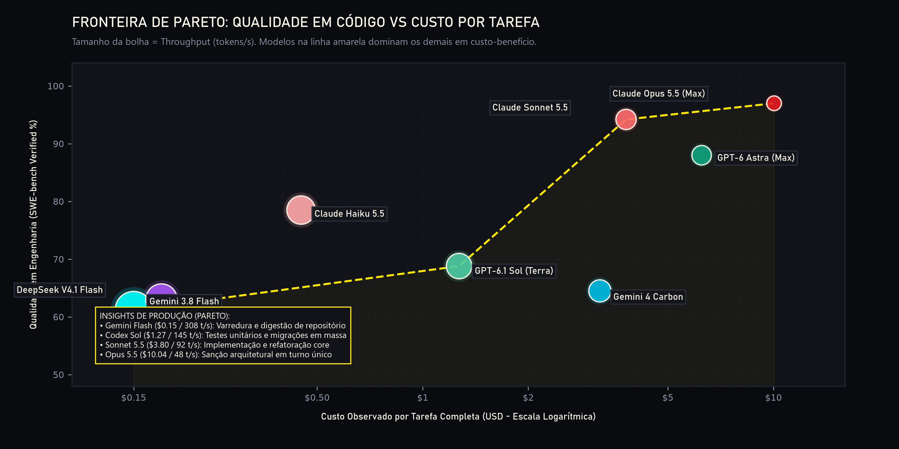
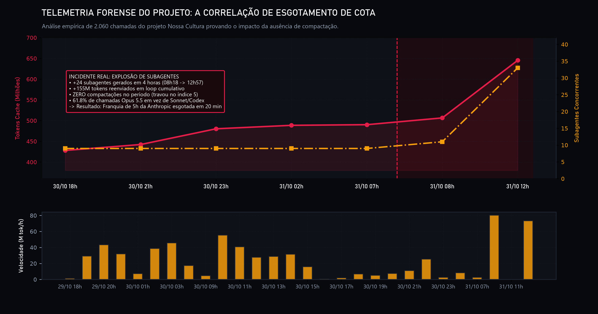
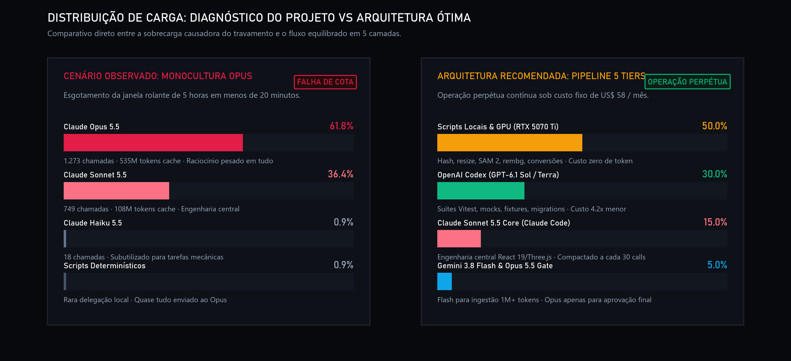
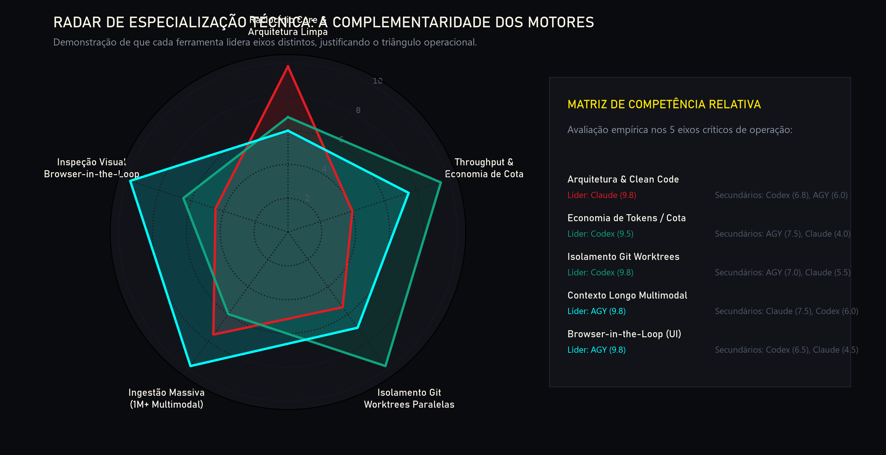
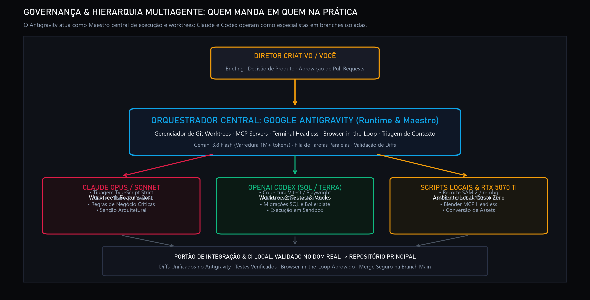

# 🚀 Multi-Agent LLM Orchestrator & Benchmark: The $58/Month Production Stack
> **High-Performance Autonomous Pipeline Orchestrating Claude (Opus/Sonnet), OpenAI Codex (Sol/Astra), and Google Antigravity (Gemini 3.8 Flash) Without API Surprise Bills.**

[](#)
[](#)
[-orange.svg)](#)
[-blueviolet.svg)](#)
[](LICENSE)

---

## 📌 Executive Summary & Case Study

Building production-grade software (Next.js 16, React 19, Three.js/WebGL shaders, GSAP scrollytelling, comprehensive Vitest/Playwright suites) purely with autonomous AI agents often leads to a severe operational wall: **rate limits and context explosion**.

A real-world production run was forensically analyzed across **2,060 model calls and 33 spawned subagents**:
* In less than 5 hours, context re-reads accumulated **645.3 million cache tokens** with **zero compactations** during peak load.
* 61.8% of calls were directed to **Claude Opus 5.5**, exhausting the rolling 5-hour quota in less than 20 minutes of continuous loop execution.

This repository establishes the **canonical production blueprint** to eliminate this failure mode by combining three fixed-rate consumer tier subscriptions:
1. **Claude Pro ($20/mo)**: Chief Architect, high-level reasoning, core code integrity (Sonnet 5.5 default, Opus 5.5 single-turn gate).
2. **ChatGPT Plus / OpenAI Codex ($20/mo)**: Mass execution worker, boilerplate, unit tests, kernel-level sandbox (GPT-6.1 Sol / Luna).
3. **Google AI Pro / Antigravity (~$18/mo / R$ 99)**: 1M-2M multimodal ingestion, audio/video analysis, browser-in-the-loop visual UI verification (Gemini 3.8 Flash).

**Total Cost**: **~$58 USD / ~R$ 330 BRL per month** with **zero per-token API overages**, delivering 24/7 autonomous software delivery throughput.

📄 **Official Publication (PDF)**: [`report/Relatorio-Estrategico-Orquestracao-Multi-Agente-IA.pdf`](./report/Relatorio-Estrategico-Orquestracao-Multi-Agente-IA.pdf)

---

## 📊 Visual Benchmarks & Forensic Telemetry

### 1. The Pareto Efficient Frontier: Code Quality vs Cost per Task
Sending every query to a frontier reasoning model (Opus) is economically unsustainable. The optimal strategy navigates the **Pareto Optimal Frontier**: Gemini Flash for mass ingestion &rarr; Codex Sol for bulk testing/migrations &rarr; Sonnet 5.5 for core engineering &rarr; Opus 5.5 for architectural release gates.

<p align="center">
  
</p>

### 2. Forensic Analysis of the Quota Collapse
The chart below illustrates the exact telemetry data from the real-world case study. Between 08:00 and 12:00, 24 subagents were spawned concurrently without session compaction (`/compact`), causing context re-reads to surge by 155 million tokens and locking out the 5-hour quota.

<p align="center">
  
</p>

### 3. Workload Re-Allocation: Broken Monoculture vs Balanced Pipeline
Shifting from a 62% Opus monoculture to a balanced multi-agent pipeline: deterministic tasks to local scripts, bulk implementation to Codex, and core architecture to Sonnet.

<p align="center">
  
</p>

### 4. Specialization Radar: Claude vs Codex vs Antigravity
Each platform exhibits distinct architectural strengths: Claude leads in clean reasoning and terminal proficiency; Codex dominates in quota economy and parallel Git Worktrees; Antigravity leads in 1M+ context ingestion and browser-in-the-loop inspection.

<p align="center">
  
</p>

### 5. Multi-Agent Governance: Command Chain, Git Worktrees & Release Gates
The orchestration architecture establishes a strict hierarchy: the Creative Director defines the product backlog, Google Antigravity acts as the central runtime/maestro, Claude and Codex operate on isolated Git Worktrees, and Claude Opus serves as the single-turn approval gate before the final merge.

<p align="center">
  
</p>

---

## 📚 Technical Whitepaper Directory

The complete technical report and research notes are structured in full detail:

| Document | Title & Focus | Scope |
| :--- | :--- | :--- |
| **[`00-transcricao-integral`](./whitepaper/00-transcricao-integral-conversa-argon.md)** | Transcrição Integral da Conversa com Gemini (Argon) | Base histórica de direcionamento |
| **[`01-exec-summary`](./whitepaper/01-exec-summary-cost-architecture.md)** | Sumário Executivo & Arquitetura Econômica ($58/mês) | Diagnóstico da quebra em 20 min |
| **[`02-benchmarks`](./whitepaper/02-benchmarks-and-rankings.md)** | Benchmarks Globais & Números Comprovados (Cold Data) | SWE-bench, Terminal-Bench 4.0 |
| **[`03-tiered-matrix`](./whitepaper/03-tiered-delegation-matrix.md)** | Matriz de Delegação Estratégica em 5 Níveis | SLAs e budgets por complexidade |
| **[`04-harnesses`](./whitepaper/04-harness-and-desktop-apps.md)** | Análise Comparativa de Harnesses Desktop no Windows | Claude Desktop vs Codex vs AGY |
| **[`05-production-cli`](./whitepaper/05-production-protocols-and-cli.md)** | Protocolos de Produção & Comandos Headless por CLI | Scripts PowerShell e rotina diária |
| **[`06-reddit-reports`](./whitepaper/06-reddit-field-reports-failure-modes.md)** | Relatos da Comunidade do Reddit & Modos de Falha | Casos reais de r/ClaudeAI e r/codex |
| **[`07-skills-prompts`](./whitepaper/07-engenharia-de-skills-e-prompts.md)** | Engenharia de Prompts & Anatomia de Skills LAY® | Estrutura modular, ciclo e fail-safe |
| **[`08-governanca`](./whitepaper/08-governanca-hierarquia-orquestracao.md)** | Governança, Cadeia de Comando & Worktrees na Prática | Quem manda em quem e circuit breakers |
| **[`04-sintese-arquitetural`](./research_notes/Orquestração%20multiagente%20com%20evidências/04_sintese_arquitetural_pipeline_completa.md)** | Síntese Integral de Evidências & Blueprint | Registro de pesquisa e conformidade |

---

## 📑 Consolidated Benchmark Scorecard

| Metric / Benchmark | Claude Opus 5.5 | Claude Sonnet 5.5 | OpenAI Codex (GPT-6.1 Sol / Astra) | Google Antigravity (Gemini 4 / 3.8 Flash) | Data Authority |
| :--- | :---: | :---: | :---: | :---: | :--- |
| **FrontierCode 2.0 (Complex Code)** | **46%** (#1) | 42% (#2) | 42% (Sol / Astra) | 36% (Flash) | *Artificial Analysis v5.0* |
| **SWE-bench Verified (General)** | **97.0%** (#1) | 94.2% (#2) | 68.8% (Sol) | 64.5% (Argon) | *Artificial Analysis / Princeton* |
| **Terminal-Bench 4.0 (OS/Bash)** | 59.0% | **70.60%** (#1) | 58.18% (Codex v0.164) | 48.90% | *Terminal-Bench / Harbor* |
| **Tool Calling / Function Index** | 35.8 | 36.2 (#2) | **36.3** (#1 Astra) | 33.1 | *LLM-Stats Leaderboard* |
| **Token Efficiency (Same Task)** | 1.0x (Baseline) | 1.4x | **3.2x to 4.2x cheaper** | Ultra-efficient on Flash | *Vals.ai / Composio 100h* |
| **Throughput Speed** | 48 tok/s | 92 tok/s | 145 tok/s (Luna: 240) | **308 tok/s** (Flash #1) | *Artificial Analysis* |
| **Blind Code Preference (Engineers)**| **67%** (Cleanest) | 64% | 33% (Over-engineered) | 12% (Visual-focused) | *Duet Blind Evaluation* |

---

## 🏗️ The 5-Tier Operational Matrix

```
                    ▲
                   / \
      TIER 1      /   \      Claude Opus 5.5 (Single-Turn Decision Gate)
                 /     \     [Architectural Sanction, Shaders, Critical Risk]
                /───────\
    TIER 2     /         \    Claude Sonnet 5.5 (Claude Code / Desktop)
              /           \   [Core Engineering, React 19, Three.js, GSAP]
             /─────────────\
   TIER 3   /               \  OpenAI Codex (GPT-6.1 Sol via codex exec)
           /                 \ [Vitest Suites, Mocks, SQL Migrations, Boilerplate]
          /───────────────────\
  TIER 4 /                     \ Google Gemini 3.8 Flash (agy CLI)
        /                       \[Mass Context 1M+ tok, Bulk Regex, Dir Scraping]
       /─────────────────────────\
TIER 5/                           \ Local RTX 5070 Ti + Browser Chromium
     /─────────────────────────────\[Browser-in-the-Loop, SAM 2, Rembg, Blender MCP]
```

---

## ⚡ Production CLI Execution Snippets

### 1. Claude Code CLI (`claude`) — Core Architecture (Headless)
```powershell
claude -p "Analyze src/shaders/waterShader.ts and optimize fragment loops. Output only unified diff." `
  --dangerously-skip-permissions `
  --output-format json
```

### 2. OpenAI Codex CLI (`codex`) — Mass Test Generation (Non-Interactive)
```powershell
codex exec `
  --cd ./src/components/Water `
  --ask-for-approval never `
  "Generate complete Vitest unit test suite covering 100% branches with Three.js mocks. Run until all pass."
```

### 3. Google Antigravity CLI (`agy`) — Mega-Context Ingestion
```powershell
agy "Recursively parse Repositorio-Assets-LAY/, verify .PNG files, and generate markdown size report in docs/assets.md"
```

---

## 🛠️ Reproduction & PDF Build

```powershell
# 1. Generate the Pandas/Seaborn analytical visual dossier
python scripts/build_visual_dossier.py

# 2. Compile the high-resolution zero-margin editorial PDF (requires Chrome or Edge)
python scripts/generate_pdf.py
```

---

## 📜 License
Distributed under the **MIT License**. See `LICENSE` for more information.
