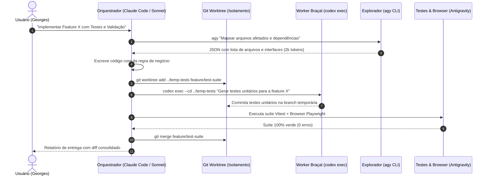

# 05. Protocolos de Produção & Comandos de Execução Headless por CLI

Para que múltiplos agentes conversem entre si sem a necessidade de intervenção humana copiando e colando texto entre telas, os agentes devem ser acionados através de seus respectivos binários de linha de comando em **modo headless (não-interativo)**.

---

## 1. O Pipeline de Comunicação Inter-Agentes



---

## 2. Sintaxe de Execução Headless por Ferramenta

### A. Claude Code CLI (`claude`) — Execução Estrutural
O comando `claude -p` (ou `--print`) roda uma instrução de forma não-interativa e cospe o resultado diretamente no stdout:

```powershell
# Chamada não-interativa do Claude para arquitetura e refatoração
claude -p "Analise o arquivo src/shaders/waterShader.ts e otimize o loop de fragment mantendo a interface pública. Retorne apenas o diff em formato unified." `
  --dangerously-skip-permissions `
  --output-format json
```
* **Flag `-p` / `--print`**: Evita a abertura da interface de chat do terminal; executa, altera o disco e encerra o processo imediatamente.
* **Flag `--dangerously-skip-permissions`**: Ignora confirmações interativas de "permitir leitura/escrita de arquivo", permitindo execução autônoma em pipelines.

---

### B. OpenAI Codex CLI (`codex`) — Execução de Trabalho em Massa
O comando `codex exec` opera com o sandbox nativo do ChatGPT Plus e isolamento de diretório:

```powershell
# Geração autônoma de suíte de testes com zero confirmações interativas
codex exec `
  --cd ./src/components/Onda `
  --ask-for-approval never `
  "Gere uma suíte completa de testes unitários Vitest cobrindo 100% dos ramos do componente Onda.tsx, incluindo mocks de Three.js e WebGLRenderer. Execute a suíte até passar."
```
* **Flag `--ask-for-approval never`**: Impede que o processo pare solicitando permissão para rodar comandos de compilação ou criação de mocks.
* **Isolamento de Diretório (`--cd`)**: Restringe a atuação do modelo exclusivamente ao módulo indicado, prevenindo efeitos colaterais em arquivos centrais.

---

### C. Google Antigravity CLI (`agy`) — Ingestão Massiva & Multimodal
O binário `agy` aproveita a assinatura do Google AI Pro (R$ 99) e a velocidade do Gemini 3.8 Flash:

```powershell
# Extração estruturada de metadados em diretório com milhares de assets
agy "Leia recursivamente a pasta Repositorio-Assets-LAY/, verifique quais arquivos possuem extensão .PNG e liste as dimensões e pesos em um arquivo markdown em docs/inventario-assets.md"
```

---

## 3. Script PowerShell de Automação de Worktrees Isoladas

Para rodar tarefas simultâneas sem perigo de colisão de código entre o Claude e o Codex:

```powershell
# scripts/dispatch-parallel-task.ps1
param (
    [string]$TaskName,
    [string]$Prompt
)

$WorktreePath = "../worktree-$TaskName"
$BranchName = "task/$TaskName"

# 1. Cria a Worktree isolada
git worktree add -b $BranchName $WorktreePath main

try {
    # 2. Despacha o trabalho para o Codex CLI dentro da Worktree
    Write-Host "[ORCHESTRATOR] Disparando Codex na Worktree: $WorktreePath" -ForegroundColor Cyan
    codex exec --cd $WorktreePath --ask-for-approval never $Prompt

    # 3. Executa testes de integridade dentro da Worktree
    Push-Location $WorktreePath
    npm run test:ci
    Pop-Location

    Write-Host "[ORCHESTRATOR] Tarefa $TaskName concluída com sucesso." -ForegroundColor Green
}
finally {
    # 4. Limpeza da Worktree
    git worktree remove $WorktreePath --force
}
```

---

## 4. Regras de Blindagem no `settings.json` do Claude Code

Para garantir que o Claude Code nunca volte a explodir a cota do usuário no Windows:

```json
{
  "model": "sonnet",
  "autocompact": "auto",
  "effort": "medium",
  "hooks": {
    "PreToolUse": [
      {
        "matcher": "Bash|PowerShell",
        "hooks": [
          {
            "type": "command",
            "command": "python scripts/validate_tool_budget.py"
          }
        ]
      }
    ],
    "SessionStart": [
      {
        "matcher": "startup|resume",
        "hooks": [
          {
            "type": "command",
            "command": "\"C:\\Users\\georg\\AppData\\Local\\Programs\\Python\\Python314\\python.exe\" \"C:\\Users\\georg\\.lay-skills\\runtime\\scripts\\skill_hub.py\" hook --agent claude --home \"C:\\Users\\georg\""
          }
        ]
      }
    ]
  }
}
```
