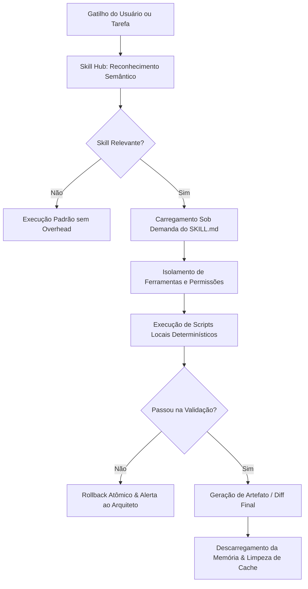

# 07. Engenharia de Prompts, Concepção e Anatomia de Skills no Ecossistema Multiagente

> **Autoridade Técnica:** Loud, Angry & Young® (LAY®)  
> **Status:** Especificação de Engenharia & Padrão de Produção  
> **Data de Atualização:** 31 de Outubro de 2026  

---

## 1. Princípios Fundamentais de Engenharia de Prompt por Motor

A orquestração eficiente de múltiplos agentes parte de uma premissa inegociável: **cada família de modelo possui uma dinâmica cognitiva, um limiar de atenção e uma sensibilidade de token completamente distintos**. Tratar Claude, Codex e Gemini com o mesmo prompt genérico é a causa primária de alucinações, desperdício de cotas e colapso de contexto.

```
                    ┌──────────────────────────────────────────────┐
                    │          DIRETRIZ DE ENGENHARIA              │
                    │        1 Promt Focado = 1 Responsabilidade   │
                    └──────────────────────┬───────────────────────┘
                                           │
         ┌─────────────────────────────────┼─────────────────────────────────┐
         ▼                                 ▼                                 ▼
┌──────────────────┐             ┌──────────────────┐              ┌──────────────────┐
│   CLAUDE 5.5     │             │    CODEX (SOL)   │              │   GEMINI FLASH   │
│  (Opus / Sonnet) │             │   (GPT-6.1/Astra)│              │     (3.8 / 4)    │
├──────────────────┤             ├──────────────────┤              ├──────────────────┤
│• Raciocínio Puro │             │• Execução Direta │              │• Ingestão Massiva│
│• Strict Typing   │             │• Sandboxed Tests │              │• Mapas de Grafo  │
│• Diff Cirúrgico  │             │• Mocks & SQL     │              │• Scanner Regex   │
│• Zero Prolixidade│             │• Loop até Verde  │              │• Triagem 1M+ tok │
└──────────────────┘             └──────────────────┘              └──────────────────┘
```

---

### 1.1. Engenharia de Prompts para Claude (Opus 5.5 / Sonnet 5.5)

O Claude é o **Engenheiro-Chefe**. Sua especialidade é arquitetura, consistência de tipos, algoritmos de shaders (WebGL/Three.js) e refatoração cirúrgica. 

#### Regras de Ouro para Claude:
1. **Instruções Negativas Claras (Anti-Patterns Explícitos)**: O Claude responde com extrema precisão a proibições categóricas (ex: *"Não crie arquivos temporários fora do escopo; não use `any`; não altere assinaturas de funções públicas"*).
2. **Saída em Diff Unificado ou Bloco Único**: Exigir sempre patches cirúrgicos ou o código integral sem placeholders como `// ... rest of code`.
3. **Estilo Caveman / Baixa Verbosidade**: Banir preâmbulos (*"Com certeza! Aqui está o seu código..."*) e sumários redundantes. O Claude deve responder direto ao ponto com código e justificativa técnica de 1 parágrafo.
4. **Isolamento de 1 Turno para Opus**: Nunca submeter Claude Opus a loops autônomos de tentativa e erro. Opus deve receber o problema já digerido, com logs de erro e diffs filtrados, emitindo a decisão arquitetural definitiva em 1 único turno.

#### Template de Prompt para Claude Code (Core Architecture):
```markdown
[CONTEXT]: Refatoração do componente src/components/CultureScene.tsx no Next.js 16.
[CONSTRAINT]: 
- Não altere a assinatura da interface CultureProps.
- Mantenha strict typing sem uso de 'any'.
- Use exclusivamente hooks do React 19 (useTransition, useActionState quando aplicável).
- Otimize o loop de renderização do Three.js para 60 FPS estáveis.
[INPUT DIFF]: <diff_contexto_filtrado>
[ACTION]: Retorne o bloco de código completo refatorado, sem texto introdutório.
```

---

### 1.2. Engenharia de Prompts para OpenAI Codex (GPT-6.1 Sol / Astra)

O Codex opera como o **Operário de Alto Volume e Testes**. Ele possui menor custo de inferência, excelente conformidade com ferramentas em sandbox e tolerância a loops fechados de execução (*run until pass*).

#### Regras de Ouro para Codex:
1. **Objetivo de Término Concreto (Exit Condition)**: O prompt deve conter uma condição de parada determinística (ex: *"Execute os testes até que 100% passem com 0 erros de tipagem"*).
2. **Contexto Fechado e Foco em Arquivo Único**: O Codex produz seu melhor código quando restrito a uma única pasta ou par de arquivos (ex: `component.tsx` e `component.test.tsx`).
3. **Instruções com Exemplos de Casos de Borda**: Fornecer a estrutura esperada de mocks e exigir testes para `null`, `undefined`, concorrência e timeout.

#### Template de Prompt para Codex CLI (Mass Test Generation):
```markdown
[ROLE]: Test Engineer
[TARGET]: src/components/CultureScene.tsx
[TEST FRAMEWORK]: Vitest 3.0 + React Testing Library + @react-three/test-renderer
[REQUIREMENTS]:
1. Cubra 100% dos branches e estados de loading/erro.
2. Mocke chamadas de WebGL e timers com vi.useFakeTimers().
3. Execute o comando `npm test -- src/components/CultureScene.test.tsx` dentro do sandbox.
4. Itere e corrija falhas autonomamente até a saída verde total.
```

---

### 1.3. Engenharia de Prompts para Google Gemini (Gemini 3.8 Flash / Antigravity)

O Gemini Flash é o **Explorador e Triador de Mega-Contexto**. Ele lê 1 milhão a 2 milhões de tokens com custo desprezível e altíssimo throughput (308 tokens/s).

#### Regras de Ouro para Gemini:
1. **Ingestão Bruta com Extração Estruturada**: Enviar dumps inteiros de diretórios, logs gigantescos ou PDFs e exigir **saída estritamente em JSON ou Markdown semântico**.
2. **Triagem Prévia de Dependências**: Usar o Gemini para mapear quais arquivos realmente importam antes de acionar Claude ou Codex.
3. **Inspeção Multimodal de UI (Browser-in-the-Loop)**: O Gemini no Antigravity inspeciona prints reais da tela do navegador, medindo alinhamento óptico, contraste de cores e renderização de WebGL.

---

## 2. Concepção e Arquitetura de uma Skill no Padrão LAY®

Uma **Skill** no ecossistema LAY não é um mero prompt de sistema. Trata-se de uma **unidade modular de capacidade técnica autônoma**, combinando documentação normativa, scripts determinísticos embutidos e diretrizes de execução fail-safe.

```
lay-skill-name/
├── SKILL.md                 # Especificação normativa (frontmatter YAML + instruções)
├── scripts/                 # Scripts determinísticos locais (Python, Bash, Node)
│   ├── validate.py          # Script de validação pré/pós execução
│   └── transform.py         # Automações de cálculo, regex ou renderização
├── references/              # Documentação oficial, normas e esquemas de dados
│   └── technical_spec.md
└── examples/                # Casos de uso canônicos e padrões de diff aceitáveis
    └── sample_output.json
```

---

### 2.1. Anatomia Formal do `SKILL.md`

Toda Skill deve seguir a estrutura semântica estrita:

```yaml
---
name: lay-nome-da-capacidade
description: "Descrição concisa de 1 a 2 linhas definindo exatamente QUANDO usar e QUANDO NÃO usar esta skill."
version: 1.0.0
author: Loud, Angry & Young®
allowed-tools:
  - read_file
  - edit_file
  - run_command
---

# Nome da Capacidade

## 1. Input/Output Signature (Contrato de Dados)
- **Input**: Parâmetros necessários, arquivos de entrada e contexto esperado.
- **Output**: Artefatos gerados, diffs validados e relatórios emitidos.

## 2. Router and Selection Matrix
Tabela de decisão determinística indicando quando esta skill tem prioridade sobre outras.

## 3. Imperative Execution Workflow
Passo a passo sequencial com marcação de rigidez:
- `[FRÁGIL]`: Etapa crítica que não tolera desvios (ex: verificação de tipos, checagem de cota).
- `[FLEXÍVEL]`: Etapa adaptativa conforme o projeto.

## 4. Execution Checklist
Checklist binário (pass/fail) antes da conclusão da tarefa.

## 5. Fail-Safe, Rollback & Circuit Breaker
O que fazer caso um script falhe ou um comando emita erro (reversão atômica).
```

---

### 2.2. Ciclo de Vida Operacional de uma Skill



1. **Descoberta Sob Demanda (Zero Context Waste)**: As skills residem no disco local (`~/.lay-skills/` ou `.agents/skills/`). O catálogo completo **nunca** é injetado no contexto inicial do LLM. Apenas a descrição curta é avaliada pelo roteador.
2. **Execução Local First**: Sempre que uma etapa puder ser realizada por um script local (`scripts/build_visual_dossier.py`, `pytest`, `eslint`, `sharp`), o modelo não escreve código do zero nem consome tokens tentando simular um compilador: ele simplesmente executa o script nativo.
3. **Fail-Safe & Rollback**: Se a skill encontrar erros irrecuperáveis, o estado anterior do Git é restaurado sem poluir o histórico ou consumir cotas em loops infinitos.

---

## 3. Diretrizes de Compactação de Contexto (Context Discipline)

O maior inimigo da produtividade de agentes em 2026 é a **re-leitura cumulativa de contexto** (penalidade de cache). Cada mensagem enviada com histórico inflado carrega centenas de milhares de tokens desnecessários.

### O Protocolo Anti-Bloqueio em 4 Passos:
1. **Regra de 30 Chamadas**: A cada 30 interações de um subagente, execute obrigatoriamente a compactação da sessão (`/compact` ou reinicialização com resumo estruturado).
2. **Remoção de Arquivos Mortos da Janela**: Nunca mantenha logs de teste completos de 5.000 linhas na memória do agente. Extraia apenas as linhas de falha via `grep` / `Select-String` antes de alimentar o modelo.
3. **Worktree Isolation**: Subagentes devem nascer em Git Worktrees limpas contendo apenas os arquivos da feature em desenvolvimento, impedindo que o modelo leia acidentalmente o repositório inteiro.
4. **Comunicação Inter-Agentes em JSON Estruturado**: Quando um agente repassa uma tarefa a outro, a mensagem de handover deve conter exclusivamente:
   - Caminho dos arquivos alterados.
   - Status dos testes (`PASS`/`FAIL`).
   - Erro específico a ser solucionado.
